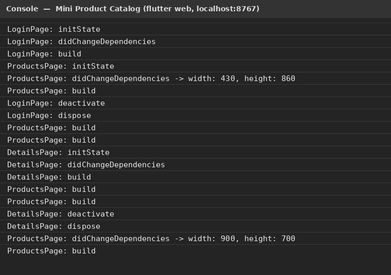
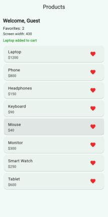
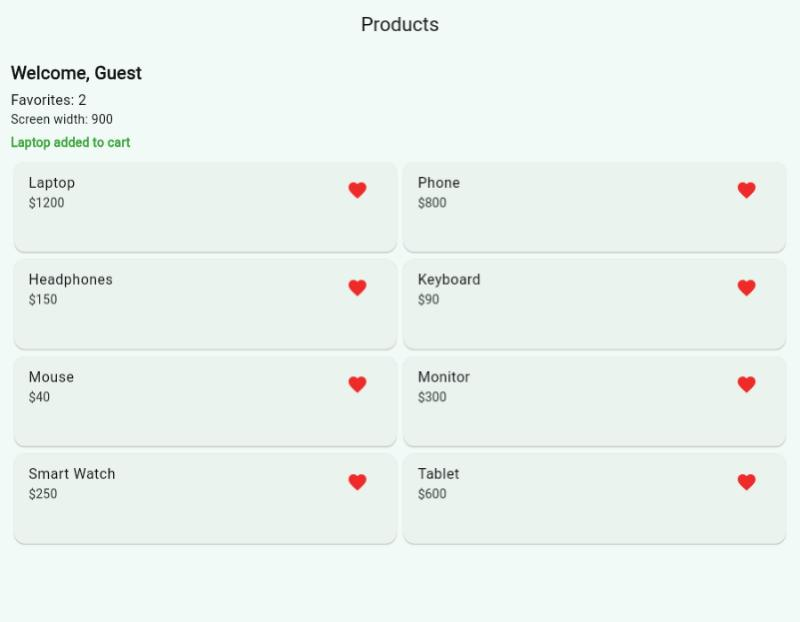

# Mini Product Catalog — Section 4 Homework (State Lifecycle & Navigation)

**Student:** Amr Ahmed El-Ghareeb

Login → Products → Product Details, built with **go_router** (the Navigator version is kept commented out).

- **Part 1 – Lifecycle:** all 3 pages are `StatefulWidget`s printing `initState`, `didChangeDependencies`, `build`, `deactivate`, `dispose`. Products page has a **Favorites** counter, reads the screen size in `didChangeDependencies` with `MediaQuery.sizeOf`, shows the width, and switches **List (< 600)** / **Grid (≥ 600)**.
- **Part 2 – Navigator:** `pushNamed` with `arguments: 'Guest'` (read with `ModalRoute.of(context)!.settings.arguments`), `push` to Details with name/price through the constructor, `pop` with a result received with `await` → commented out in the code.
- **Part 3 – go_router:** `/` → Login, `/products?user=Guest` (query parameter, `goNamed`), `/details/:name/:price` (path parameters, `context.push` + `await`), `context.pop("... added to cart")`.
- **Answers** to Part 1 (a–d) and Part 4 (1–3) are in the comment at the top of `lib/main.dart`.
- Uses the provided helper `lib/product_widgets.dart`.

## Screenshots
| Debug console (lifecycle prints) | List (width 430) + cart result | Grid (width 900) |
|---|---|---|
|  |  |  |

## Run
```bash
flutter pub get
flutter run -d chrome
```
